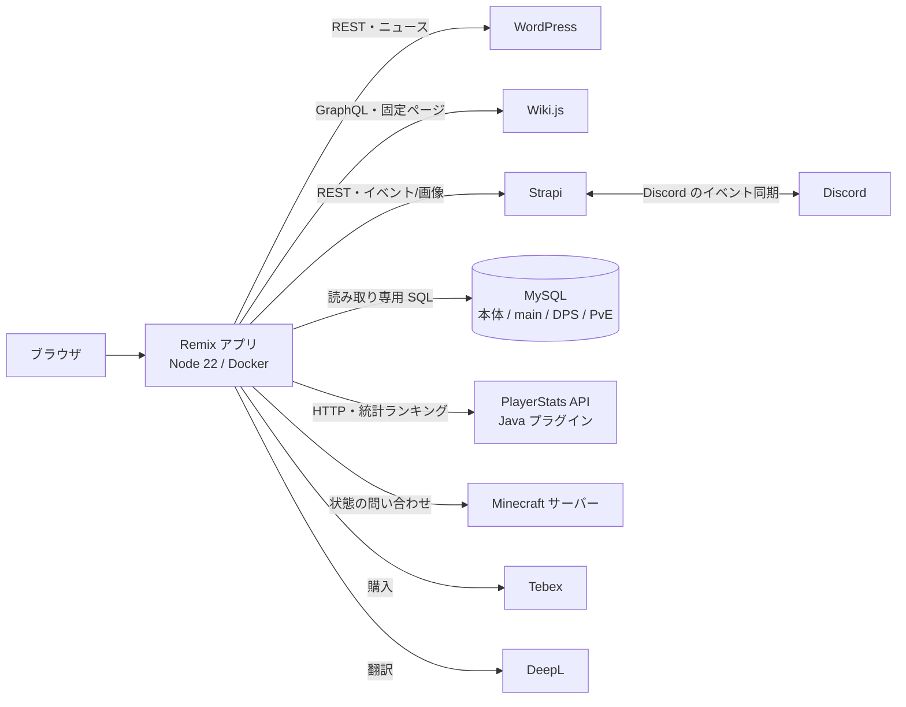

# mofucraft-site

**Remix(React + TypeScript)・複数のデータ源を 1 つのサイトにまとめる・Docker で自動デプロイ**

Minecraft サーバー **MOFUCRAFT!!!**(2014 年〜運営)の公式サイトです。
ニュース・Wiki・ランキング・処罰記録・ギャラリー・イベント・寄付ストアなど、**別々のシステムにあるデータを 1 つの画面にまとめて見せる**ために作っています。

> このリポジトリは、実運用中のサイトから**秘密・内部の宛先・スタッフの個人情報・画像を抜いた公開用の写し**です(履歴は 1 コミット)。
> そのままでは動かしません(連携先がありません)。**構成と実装を読んでもらう**ための版です。実物: https://mofucraft.net

## 何を解決するか

| 困りごと | この構成での答え |
|---|---|
| ニュース・Wiki・イベント・ゲーム内の記録が、別々のサービスに散らばっている | 1 つの Remix アプリがサーバー側(loader)でまとめて取り、キャッシュして 1 ページで見せる |
| サイトからゲームのデータベースを壊したくない | データベースは**読み取り専用のユーザー**でつなぐ。書き込みの SQL は 0 件 |
| 更新のたびにサーバーに入って作業したくない | `main` への push で、GitHub Actions → SSH → `docker compose` で自動デプロイ(見本は `docs/deploy.example.yml`) |
| 外部 API の呼びすぎ・乱用が心配 | キャッシュ(3〜5 分など)と、IP 別・全体のレート制限(メモリ上) |

## 構成



| データ | 置き場 | サイトでの用途 |
|---|---|---|
| ニュース | WordPress | `news`(記事一覧・本文) |
| 固定ページ・メニュー | Wiki.js | ガイド・規約などの文書、サイドバー |
| Discord イベント・ギャラリー画像・武器やコミュニティの定義 | Strapi | トップページ・`weapons`・`communities` |
| ゲーム内の記録(所持金・プレイ時間・処罰・権限・投票) | MySQL(読み取り専用) | `miscs`(ランキング)・`punishments`・`players`・`staff` |
| プラグインの記録(最大 DPS = MofuDPS〔自作〕・武器の使用回数/討伐数 = MofuPvE〔スタッフの作〕) | MySQL(別 DB) | `weapons`(ランキング) |
| 統計ランキング | PlayerStats の HTTP API | `miscs.rankings`(5 分キャッシュ) |

主なコード: `app/routes/`(ルート 26 ファイル、うち API 4)・`app/utils/*.server.ts`(連携先ごとの取得処理)・`app/components/`。TypeScript/TSX で約 1.8 万行。

## 動かし方(連携先を用意できる場合)

```sh
cp env.example .env     # 各連携先の URL と鍵を入れる(.env は Git に入れない)
npm ci
npm run dev              # http://localhost:3000
npm run build && npm start
# 本番: docker compose up -d --build
```

画像(`public/`)は含めていません。

## AI の使い方と、自分がしたこと
<!-- 下書き: 内容は本人が確認して直す(過去の発言とコードから起こした) -->

- **共同開発**: 運営スタッフ 1 名と共同で開発しています(元のリポジトリの約 18%・76/429 コミットがその人の作で、この写しにも含まれます)。**自分が担当したのは**、仕様と構成の決定・連携先の役割分担・データベースを読み取り専用にする線引き・デプロイと運用・動作確認、そして実装の大部分(AI への指示を含む)です。
- **土台は自力**: 2025 年より前の公式サイトは、自分で書いた HTML/CSS(中学で 1 から書き、高校でデザインを変更)でした。
- **2025 年から Remix で作り直し**。実装の大部分は AI コーディングエージェント(GitHub Copilot・ChatGPT・Claude Code)に指示して書かせています。元のリポジトリは 429 コミットで、うち約 60 は AI が作者です。リポジトリの `CLAUDE.md` は、AI に渡している仕様書です。
- **自分が担当したこと**: 何を作るか(ページ・見せるデータ)の決定/連携先の役割分担(ニュース=WordPress、固定ページ=Wiki.js、イベントと画像=Strapi、ゲームの記録=MySQL)/データベースを読み取り専用にする線引き/デプロイの仕組みと本番での更新/動作確認と、落ちたときの原因確認。
- **なぜ Remix か**: 記事をサーバー側で描画したかった。自前のサーバーに置く前提で、Web 標準(Request/Response・フォーム)に沿って書けて、データ取得を loader に集められ、Node で素直に動かせるため。
- **AI の出力を鵜呑みにしていないこと**: `CLAUDE.md`(AI 向け仕様書)は実際のコードと食い違うことがあり(例: 仕様書にある「再試行と 2 秒の間隔」はコードに無かった)、**書く・言うのはコードで確認できたことだけ**にしています。

## 確認できている点 / 弱い点(正直に)

**できている**
- 書き込みの SQL が 0 件。値は全てプレースホルダで渡す。
- 秘密のコード直書きは 0(`.env` から読む)。API は入力検証と、IP 別・全体のレート制限。
- 本番で動いている(mofucraft.net)。更新は `main` への push で自動。

**弱い点(直す候補)**
- **テストがありません。** 型検査(`npm run typecheck`)は 12 件、lint は 96 件のエラーが出ます(ビルドは通ります)。
- デプロイが `docker compose down` → `up --build` の順で、その間は短く止まります(`up -d --build` だけにすると短くできる)。
- 外部呼び出しのタイムアウトが一部だけ。失敗した値でキャッシュを上書きする箇所がある。レート制限がメモリ上(再起動で消える・複数台に向かない)。
- `app/data/staff-profiles.json` はこの写しでは**見本の値**です(実物はスタッフ本人の情報なので抜いています)。

## ライセンス

【あなたが決める: このリポジトリのコードのライセンス。決めるまでは書かない(=すべての権利を保持)】
